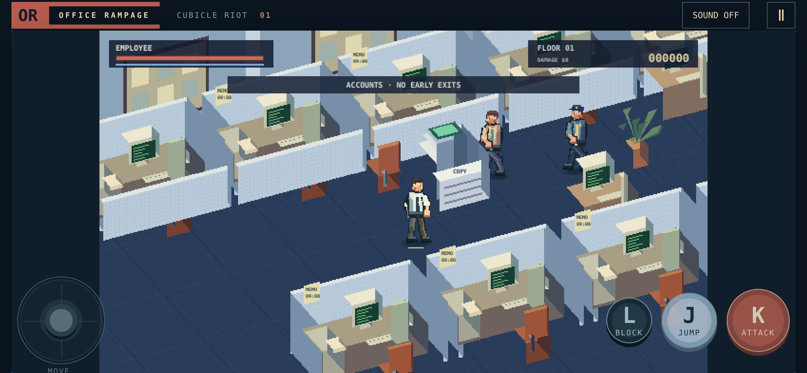

# Office Rampage — Cubicle Riot

An original HTML5 beat-'em-up for iPhone landscape and desktop, revised toward the office perspective and Jump / Attack / Block controls of [Rising Up](https://twitwi.itch.io/risingup).

**[Play](https://azaidx-create.github.io/office-rampage/)** · **[Animation Lab](https://azaidx-create.github.io/office-rampage/tools/animation-lab.html)**



## Controls

| Action | Touch         | Keyboard      |
| ------ | ------------- | ------------- |
| Move   | Left joystick | WASD / arrows |
| Jump   | JUMP          | J / Z / Space |
| Attack | ATTACK        | K / X         |
| Block  | Hold BLOCK    | Hold L / C    |
| Pause  | Pause button  | P / Escape    |

Chain attacks for a three-hit combo. Jump then attack for an aerial kick. Face an incoming hit while holding block; the blue guard meter depletes under pressure and refills after release. Blocking just before impact parries. Smash furniture to clear the aisle, rack up property damage, and collect coffee from copiers/plants for health.

Clear three encounters and eight opponents, including the floor manager, then enter the elevator at the far end of the aisle. Sound is opt-in. Focus loss and hidden pages pause the game.

## This revision

- Angled, depth-sorted cubicle aisles replacing the flat sunset office.
- CRT monitors, partition fabric, wall memos, noticeboards, copier trays, office chairs, carpet texture and an elevator.
- Smaller heads and slimmer character proportions, with discrete raster animation frames, including new jump, aerial kick and block sequences.
- Jump physics, directional blocking, guard breaks, a short parry window and one aerial attack per jump.
- Solid breakable desks, chairs and copiers, plus a property-damage counter.
- Screen-relative joystick movement through the oblique projection; foreground cubicles fade when they obstruct the player.
- Original artwork/code; no downloaded reference sprites. [Reference observations and limits](docs/reference-notes.md).

## Run and test

```sh
python3 -m http.server 8000
# Open http://localhost:8000
npm test

# Optional WebKit browser tests:
npm install --no-save playwright@1.62.1
npx playwright install --with-deps webkit
npm run test:browser
```

No runtime dependencies, CDN or build step. ES modules require HTTP(S), not file://. The existing GitHub Pages workflow publishes main.

Validation: 15 simulation/projection/animation tests, including an input-driven full-level clear without health overrides. WebKit checks at 844×390, 390×844, 667×375 and 1280×800 cover touch/keyboard input, simultaneous movement and attack, jump, held block, pause, focus loss, release, restart, bounds and distinct animation frames. Physical iPhone testing remains outstanding.

## Source

- `src/engine.js`: fixed-step combat, collision, jump/guard and encounters.
- `src/art.js`: original character palettes and authored raster animation frames.
- `src/office.js`: oblique projection and cached office furniture/scene artwork.
- `src/game.js`: input, animation playback, sound, camera, particles and UI.
- `tools/animation-lab.html`: pause and inspect individual frames.

The `?debug` query enables `window.__office` for local inspection. Normal play does not expose it.

### Pipe combat update

Press Attack near a floor pipe to pick it up. Pipes have eight swings, longer reach and a dedicated six-frame animation. Taking an unblocked hit drops your pipe; defeated guards drop replacements. Two additional simulation tests cover pickup, reach, hit deduplication, durability, disarming and guard drops (17 passing in total). Browser checks from the previous release have not been rerun for this update.

## 3D test floor

Open `prototype3d/` for a separate fully polygonal office prototype. WASD/arrows or touch stick move; Space/Attack strikes; E/Use picks up the pipe. Defeat the single guard and enter the green rear exit. Desks break, pipes wear out and drop when hit. P or focus loss pauses. Restart resets the room.

This uses original articulated box-mesh characters with procedural joint animations, not finished character models or motion capture. Four simulation tests pass (`npm run test:3d`); browser rendering and physical iPhone performance remain unverified because the test-browser download failed. Three.js is bundled locally, with its MIT license included. Build with `npm install` and `npm run build:3d`.

### Character update

The 3D prototype now loads Quaternius Casual_2 from Ultimate Modular Men (CC0), replacing box-mesh fighters with skinned character meshes and six authored animation clips. See `prototype3d/assets/CREDITS.md`. The model uses colored materials rather than image textures. A software-rendered model preview is included at `prototype3d/assets/preview.png`; this verifies asset appearance, not live WebGL rendering. Loading is gated and reports errors. Current browsers supporting DecompressionStream are required for the compressed model. The four simulation tests pass; physical iPhone and live browser visual checks remain pending.
